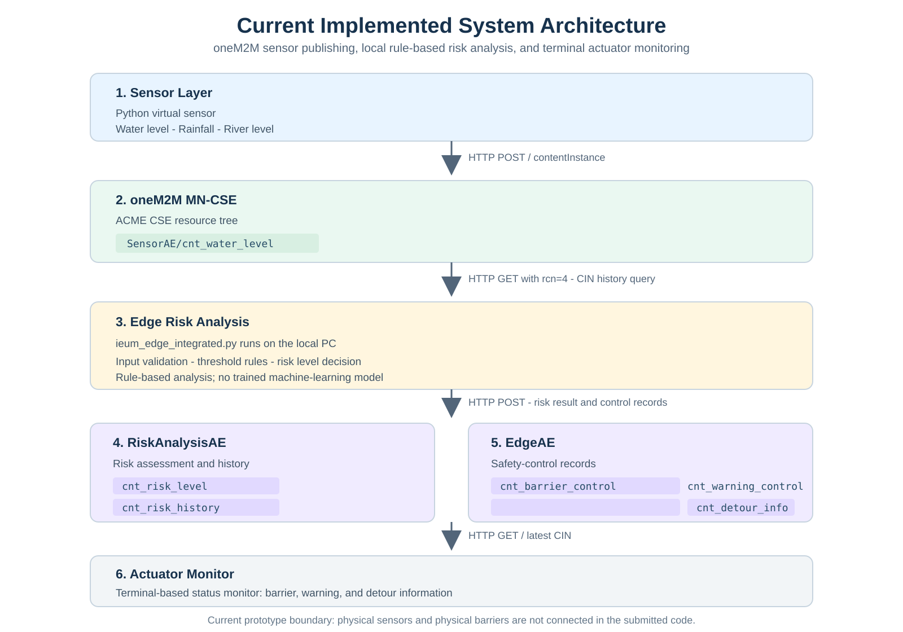
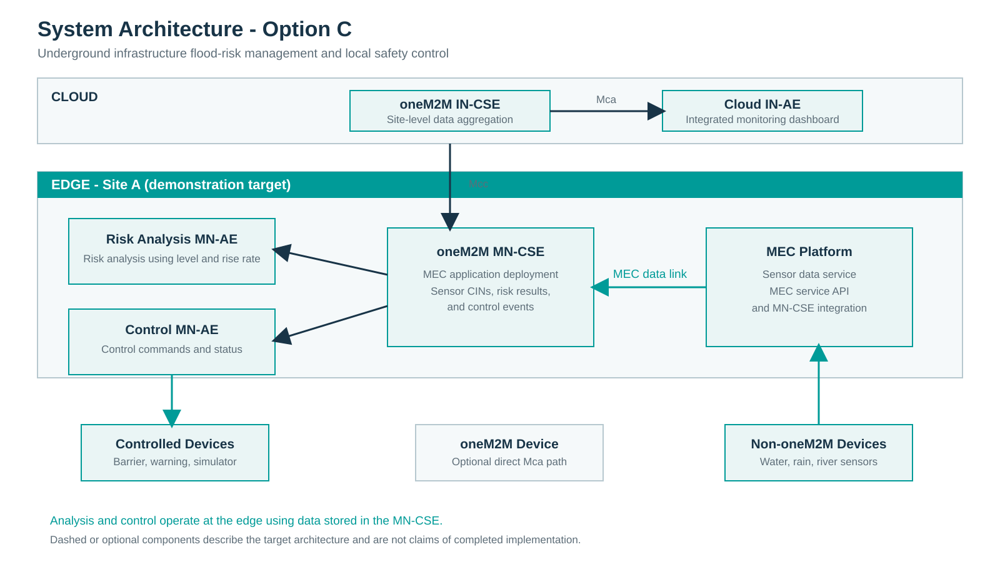
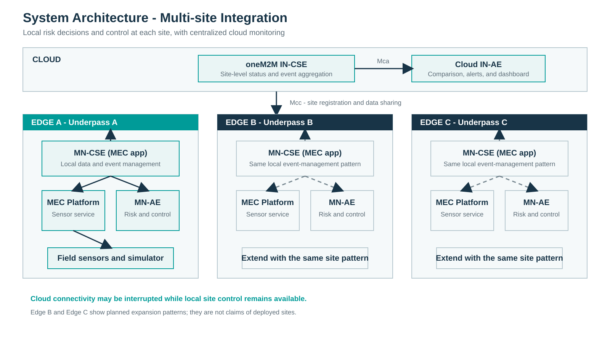
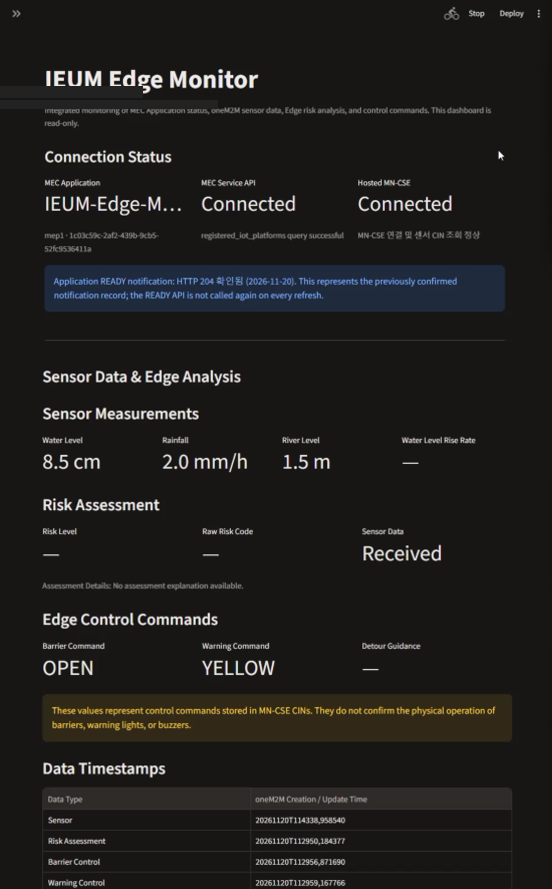

# IEUM: Edge Flood Safety for Underground Infrastructure

IEUM is a oneM2M-based prototype for flood-risk assessment and safety-control information in underground infrastructure such as underpasses.

The repository contains:

- A simulated sensor publisher for water level, rainfall, and river level data.
- A rule-based edge risk engine.
- oneM2M resources for risk results and safety-control records.
- A terminal actuator monitor for barrier, warning, and detour records.

This is a software prototype. Physical sensors, barriers, LEDs, and buzzers are not connected in the submitted code.

## Architecture

### Current Implemented Architecture



This diagram shows the submitted prototype flow. The sensor generator, risk engine, and actuator monitor run as Python processes on the local PC and exchange data with the ACME MN-CSE through the oneM2M HTTP API.

### Target Architecture: Option C



This diagram represents the target Option C architecture described in the project materials. Dashed or planned components are not claims of completed implementation.

### Target Multi-site Expansion



This diagram illustrates a planned multi-site expansion in which each edge site has its own MN-CSE and local analysis/control components. The submitted code and verified tests cover the documented prototype scope, not full multi-site deployment.

```text
Sensor simulator
    |
    v
SensorAE/cnt_water_level
    |
    v
ieum_edge_integrated.py
    |
    +--> RiskAnalysisAE/cnt_risk_level
    +--> RiskAnalysisAE/cnt_risk_history
    +--> SensorAE/cnt_water_level_rate
    +--> EdgeAE/cnt_barrier_control
    +--> EdgeAE/cnt_warning_control
    +--> EdgeAE/cnt_detour_info
                                      |
                                      v
                         Terminal actuator monitor
```

The Python processes run on the local PC and exchange data with an ACME MN-CSE through the oneM2M HTTP API. The supplied records confirm Hosted MEC/MN-CSE connectivity checks, but do not prove that the Python risk engine runs inside the MEC host.

## oneM2M Resource Tree

```text
MN-CSE
├── SensorAE
│   ├── cnt_water_level
│   └── cnt_water_level_rate
├── RiskAnalysisAE
│   ├── cnt_risk_level
│   └── cnt_risk_history
└── EdgeAE
    ├── cnt_barrier_control
    ├── cnt_warning_control
    └── cnt_detour_info
```

## Risk Analysis

`ieum_edge_integrated.py` uses deterministic threshold rules. It is not a trained machine-learning model.

The engine considers:

- Water level
- Rainfall
- River level
- Missing values
- Sequential water-level rise rate

The output levels are `NORMAL`, `CAUTION`, `DANGER`, and `EMERGENCY`. Missing readings and a closed barrier result in a conservative locked state. Automatic reopening is not implemented as a normal recovery action.

The thresholds are demonstration parameters only and are not certified flood-safety limits.

## Requirements and Installation

Python 3.10+ and the `requests` package are required.

```powershell
py -m venv .venv
.\.venv\Scripts\Activate.ps1
py -m pip install -r requirements.txt
```

## Configuration

Copy `.env.example` to `.env` for reference, then set the variables in each PowerShell session. The current integrated script reads environment variables directly; it does not automatically load a `.env` file.

```powershell
$env:IEUM_CSE_BASE_URL = "https://example.invalid/mn-cse"
$env:IEUM_VERIFY_TLS = "true"
```

Do not commit real endpoints, credentials, tokens, or Sandbox identifiers.

## Execution

Run commands from the `src` directory.

### Prepare or check resources

```powershell
py .\ieum_edge_integrated.py --setup
py .\ieum_edge_integrated.py --check
```

`--setup` creates the configured AEs and Containers when permitted and reuses resources after a supported conflict response. The current code still requires an environment-specific verification of already-registered AE errors.

### Run the integrated pipeline

Open separate PowerShell windows:

```powershell
# Window 1
py .\ieum_edge_integrated.py --run-actuator

# Window 2
py .\ieum_edge_integrated.py --watch

# Window 3
py .\ieum_edge_integrated.py --run-sensor --scenario flood
```

Supported scenarios:

```text
flood
rain
river
missing
```

Additional modes:

```powershell
py .\ieum_edge_integrated.py --once
py .\ieum_edge_integrated.py --watch --state-file ieum_edge_state.json
```

The standalone companion scripts can also be run directly, but their source contains fixed connection settings. The integrated modes are the intended way to apply the configured CSE base URL without modifying those original files.

## Monitoring Dashboard

The IEUM Streamlit dashboard is a read-only monitoring interface for the locally executed prototype. It displays MEC application and platform status, MEC Service API reachability, Hosted MN-CSE connectivity, latest sensor measurements, available risk assessments, Edge control records, timestamps, and risk history.

The dashboard does not calculate flood risk and does not issue actuator commands. The rule-based calculation and control-record writing remain the responsibility of `src/ieum_edge_integrated.py`.

Install the dashboard dependencies from the repository root:

```powershell
py -m pip install -r requirements.txt
```

Set the dashboard and CSE environment variables in the PowerShell session. The dashboard and the integrated edge script use `IEUM_CSE_BASE_URL`; it does not automatically load `.env` files.

```powershell
$env:IEUM_CSE_BASE_URL = "https://example.invalid/mn-cse"
$env:IEUM_VERIFY_TLS = "true"
$env:IEUM_CSE_ORIGIN = "CAdmin"
$env:IEUM_MEC_SANDBOX_PREFIX = "https://example.invalid"
$env:IEUM_MEC_PLATFORM = "mep1"
```

Run the dashboard from the repository root:

```powershell
py -m streamlit run dashboard\dashboard.py
```

Open `http://localhost:8501`. The dashboard is executed on the user's local PC and is not claimed as a MEC-Host deployment.



*Sanitized dashboard overview; the visible control values are stored records and do not confirm physical actuation.*

## Verification Status

Historical local ACME records show:

- Sensor ContentInstance creation with HTTP 201.
- Latest CIN retrieval with HTTP 200.
- Risk result and history storage with HTTP 201.
- Edge control CIN creation and retrieval with HTTP 201/200.
- ACP permission failures with HTTP 403 followed by permission adjustments.

Historical Hosted MEC records show successful timing, service-management, and MN-CSE base-resource HTTP 200 checks.

The following remain unverified in the current repository:

- Current Hosted Sandbox full end-to-end rerun.
- IN-CSE remoteCSE registration and synchronization.
- Python execution inside the MEC host.
- Physical actuator operation.
- Hardware sensor input.
- Machine-learning inference.

See [docs/test-results.md](docs/test-results.md) for evidence boundaries.

## Documentation

- [Architecture](docs/architecture.md)
- [Development history](docs/development-history.md)
- [Test results](docs/test-results.md)
- [Demo scenario](docs/demo-scenario.md)
- [MEC Sandbox notes](docs/mec-sandbox.md)
- [Limitations and future work](docs/limitations-and-future-work.md)
- [Dashboard integration](docs/dashboard-integration.md)
- [Evidence policy](evidence/README.md)

## Team

Team IEUM developed this prototype for the oneM2M International Developer Competition.
